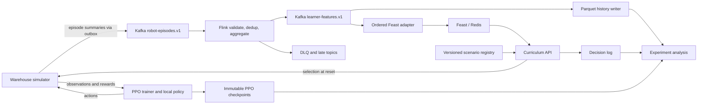

# Architecture

## Two distinct loops

## Training boundary

PPO consumes local on-policy rollout buffers. Kafka stores completed episode summaries, not a replay buffer for PPO updates. Scenario selection occurs at reset, with one selection context frozen per rollout collection block; policy weights change only at normal optimizer boundaries. Use one environment initially; vectorized environments are a gated extension.

The simulator writes summaries and decision references to a durable bounded outbox. A publisher retries until broker acknowledgement. At capacity, pause before the next episode rather than silently losing evidence. Current action execution does not wait on the curriculum network path; timeout uses local seeded fallback.

## Streaming boundary

Partition episodes by (run_id, learner_id); group features additionally by scenario family and difficulty bucket. Never aggregate across runs or mix evaluation with training. Flink produces full snapshots, not increments. Stable operator IDs, checkpoints and transactional Kafka output provide the intended Flink-to-Kafka guarantee; consumers read committed transactions.

The Feast adapter is at-least-once: push full rows through the supported API, then commit input offsets. M0 must prove replay, same-as_of revision, stale rejection and ownership-change behavior. An in-memory cache or read-then-write check is not an atomic guarantee. Resolve a supported guarded-write strategy if the provider alone cannot enforce ordering.

Archive feature snapshots separately to Parquet with identities, source offsets and first availability. Do not assume the offline provider supports streaming pushes. Record the exact feature values/versions used in each decision because asynchronously available history is not necessarily what a request observed.

## Planned layout

- simulation/: environment, reward, scenario registry and deterministic tests.
- training/: PPO runner, rollouts, checkpoints and seeded curricula.
- evaluation/: frozen suites, analysis and learning-curve reports.
- schemas/: episodes, decisions, snapshots, registry and API contracts.
- streaming/: Java Flink features and oracle comparisons.
- feature_repo/: Feast entities and feature service.
- services/feature_adapter/, services/history_writer/, services/api/.
- services/telemetry/: durable outbox publisher and replay generator.
- infra/, scripts/, tests/: local stack, commands, CI, fault/load checks.

## Freshness and failure

Provisional budget: ingress 250 ms, aggregation schedule 1 s, checkpoint visibility 2 s, adapter 750 ms, margin 1 s. Validate rather than promise it. Bounded retries pause consumers on dependency failures. Quarantine invalid records with reason codes and delivery identities. Never reset offsets to latest to hide lag.

Persistent local volumes support process restart, not disaster recovery or production HA. Rebuild feature namespaces separately before switching readers. Training checkpoint rollback creates a new run_id with parent lineage, avoiding contamination by results from discarded training.
