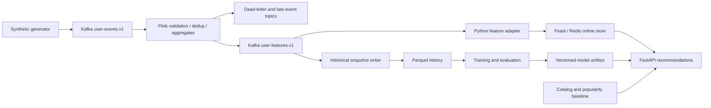

# Architecture

## Data flow

## Boundaries and choices

Kafka partitions user events by user_id. Flink validates, deduplicates, and computes user aggregates. It emits full feature snapshots rather than increment commands. A Python consumer uses the supported Feast push interface; Flink never writes arbitrary Redis keys as a substitute for Feast.

Flink checkpointing plus transactional Kafka output is the intended guarantee for the Flink-to-Kafka boundary. Downstream consumers use read_committed. The feature adapter is at-least-once: commit offsets only after successful online writes, preserve per-key ordering, and retry the identical full snapshot after a crash.

M0 must prove stale-update rejection and retry behavior for the selected Feast provider. A read-then-write comparison alone is not an atomic guarantee. Prefer one ordered writer per partition with consumer fencing and provider timestamp enforcement. If the provider cannot prevent stale writes during ownership changes, document and test a supported guarded write design before claiming monotonicity. Do not conceal this behind an in-memory offset cache.

Offline history is a separate idempotent consumer of feature snapshots. Store event-time cutoff, first availability time, schema version, source partition/offset, and snapshot identity. This avoids assuming that a local Parquet provider supports streaming offline push. Reconcile online and offline consumers using identities and offsets.

## Runtime layout to create

- infra/: Compose services, health checks, metrics configuration.
- schemas/: JSON Schema and valid/invalid fixtures.
- services/generator/: seeded event producer.
- streaming/: Java Flink job and deterministic tests.
- feature_repo/: Feast entities, feature views, service definition.
- services/feature_adapter/: ordered push consumer.
- services/history_writer/: immutable Parquet snapshots and manifest.
- services/api/: retrieval, feature assembly, ranker, fallback.
- training/: temporal joins, fitting, evaluation, artifact export.
- tests/: contracts, integration, recovery, end-to-end, and load.
- scripts/: reproducible entry points.

## Backpressure and failure handling

Bound every queue and retry interval. Transient store failure pauses consumption without committing offsets. Invalid events go to a bounded, monitored DLQ with reason codes. Poison feature snapshots are quarantined with alerting and an explicit offset-resolution procedure; do not silently skip them.

Keep checkpoints on a persistent local volume for the MVP. A local single-node broker and Redis are not production HA. Acknowledged writes lost with a destroyed volume are outside the local restart guarantee.

## Freshness budget

Provisional allocation: ingestion 250 ms, aggregation scheduling 1 s, checkpoint/transaction visibility 2 s, adapter 750 ms, remaining 1 s margin. Validate the total in M0/M3. Watermarks determine event-time completeness; they must not force every provisional online update to wait for lateness to expire.
